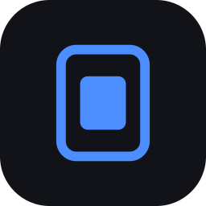
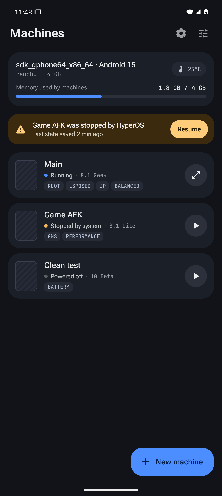
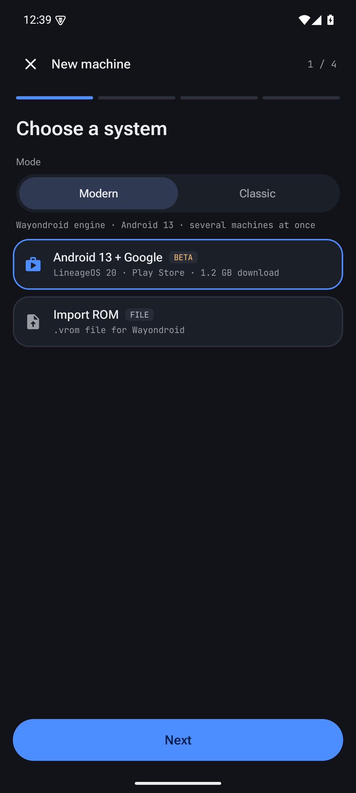
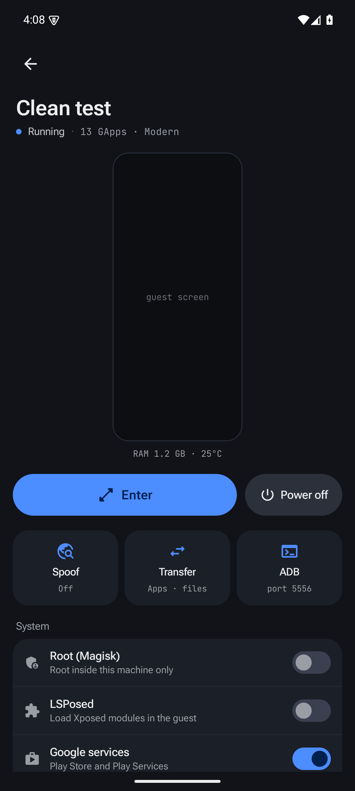
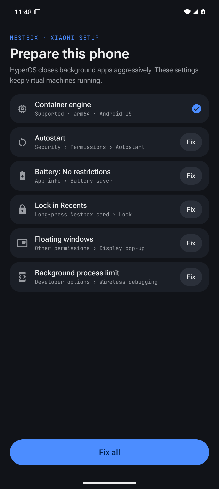
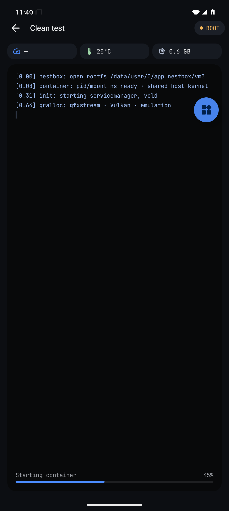
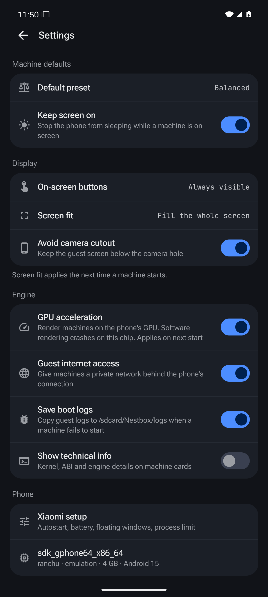

<div align="center">



# NestBox

### A second Android inside your phone — no root, no PC

[](https://github.com/rifatrajbd/NestBox-An-Android-Emulator-Support-Lineage-OS/releases)
[](https://github.com/rifatrajbd/NestBox-An-Android-Emulator-Support-Lineage-OS/releases)
[](#-device-compatibility)
[](#-engine)
[](LICENSE)
[](https://github.com/rifatrajbd/NestBox-An-Android-Emulator-Support-Lineage-OS/stargazers)

</div>

NestBox runs full virtual Android machines inside a normal app, in the style of VMOS. It boots
**LineageOS 20 (Android 13) with Google apps** on the phone's own GPU, and is tuned to survive Xiaomi's HyperOS, which closes background apps aggressively.

> [!WARNING]
> **Early alpha.** Tested on one phone so far (Redmi Note 14 Pro+, HyperOS 3). Expect bugs, and
> do not keep anything important only inside a machine yet.

## 📑 Contents

- [Features](#-features)
- [Screenshots](#-screenshots)
- [Engine](#-engine)
- [Device compatibility](#-device-compatibility)
- [Download and install](#-download-and-install)
- [First-time setup](#-first-time-setup)
- [Using NestBox](#-using-nestbox)
- [Build from source](#-build-from-source)
- [FAQ and troubleshooting](#-faq-and-troubleshooting)
- [Roadmap](#-roadmap)
- [Credits and license](#-credits-and-license)

## ✨ Features

- **No root needed** — machines run as normal app processes on the phone's own kernel
- **Android 13 with Google Play** (an Android 12 engine is in progress, see the roadmap)
- **GPU acceleration** through gfxstream on the phone's Vulkan driver (Adreno tested)
- **Full-screen machines, VMOS-style** — no controls on top; tap with **three fingers** to minimize
- **Machine cards** keep the last screen with **Enter** and **Power off**
- **Several machines at once**, each in its own process with a Stop notification
- **Survives HyperOS** — kill detection with **Resume**, plus a guided Xiaomi setup
- **Lifts Android's 32-process limit by itself** through in-app Wireless debugging pairing, no PC
- **Low memory mode** — Android Go settings, smaller app heaps and fewer cached apps
- **Presets** instead of sliders: Battery (pauses when minimized), Balanced, Performance
- **Boot logs saved automatically** to `/sdcard/Nestbox/logs` when a machine fails to start
- **Download or import** systems, and delete machines to free their storage
- **Root inside the machine** (the phone stays unrooted): `su` for apps and shells
- **Transfer** — copy installed phone apps (split APKs too) or any APK into a machine, and a
  shared folder: phone `/sdcard/Nestbox` ↔ guest `/sdcard/Host`
- **Spoof** — region (time zone, language, carrier), device model, and location (Android 12+)

## 📸 Screenshots

<p align="center">
  
  
  
  
</p>
<p align="center">
  
  
</p>

<p align="center"><sub>Machines · New machine · Minimized machine · Xiaomi setup · Boot console · Settings (UI shown on an emulator)</sub></p>

## 🧩 Engine

| | |
|---|---|
| Engine | [Wayondroid](https://github.com/yoro1836/wayondroid): tawcroot rootless runtime, userspace binder, gfxstream GPU |
| Guest | LineageOS 20 · Android 13 (+ Google apps), or your own Wayondroid `.vrom` |
| Download | 1.2 GB |
| Storage per machine | ~6 GB |
| Machines at once | several |

## 📱 Device compatibility

| Phone | Status |
|---|---|
| Redmi Note 14 Pro+ · Snapdragon 7s Gen 3 · Adreno 810 · HyperOS 3 (Android 16) | ✅ Android 13 boots and runs |
| Other Snapdragon (Adreno) phones | ❔ untested, expected to work |
| MediaTek / Exynos (Mali) phones | ❔ untested; GPU path not tried |
| x86_64 emulators | 🧪 demo engine only (UI testing) |

**Minimum:** arm64 phone, Android 10, 6 GB RAM, 8 GB free storage.
**Recommended:** 12 GB RAM, Adreno GPU, Wi-Fi for the one-time setup.

> [!NOTE]
> Android 4.4 and other 32-bit systems cannot run: recent phones like the Snapdragon 7s Gen 3
> have no 32-bit CPU mode.

## ⬇️ Download and install

1. Download `NestBox-<version>-debug.apk` from [Releases](https://github.com/rifatrajbd/NestBox-An-Android-Emulator-Support-Lineage-OS/releases).
2. Open it on the phone and allow installing from your browser or file manager.
   On HyperOS, accept the security scan prompt.
3. Open NestBox and follow the Xiaomi setup below.

The app id is `app.nbox`. Debug builds are signed with a debug key, so updates install over each other.

## 🛠 First-time setup

The **Xiaomi setup** screen opens on first launch. Tap **Fix** on each row:

| Row | What to do |
|---|---|
| Autostart | Turn it on in the screen that opens |
| Battery: No restrictions | Choose *No restrictions* |
| Lock in Recents | Open Recents, long-press the NestBox card, tap the lock |
| Floating windows | Allow *Display pop-up windows* |
| Background process limit | See below |

**Background process limit.** Android stops apps that run more than 32 processes, and a guest runs
60 or more. NestBox turns the limit off through Wireless debugging on the phone itself:

1. Connect to Wi-Fi and tap **Open Wireless debugging**.
2. Turn Wireless debugging on and tap **Pair device with pairing code**.
3. Type the 6-digit code into the **NestBox notification**.

> [!TIP]
> If HyperOS refuses the change, turn on **USB debugging (Security settings)** in Developer options
> and pair again.

Allow notifications and storage when asked; storage is only used for boot logs.

## 🚀 Using NestBox

- **New machine** → system → preset and resolution → features → **Create and start**.
- The first start downloads and unpacks the system. To skip the download, copy the `.vrom` to the
  phone's **Download** or **Nestbox/roms** folder first; NestBox finds it by size and checksum.
  The first Android 13 boot takes several minutes while it compiles apps; later boots are much faster.
- **Inside a machine:** the phone's back gesture goes to the guest. **Tap with three fingers** (or
  press Home) to minimize.
- **Machine card:** last screen, live RAM and temperature, **Enter**, **Power off**, and below that
  system switches, performance and maintenance (including **Delete machine**).

**Transfer** (machine card › Transfer, machine running):
- **Apps:** **Copy** installs a phone app in the machine; **Install APK from storage** takes any APK.
- **Files:** put files in the phone's `/sdcard/Nestbox`; the guest sees them in `/sdcard/Host`.
  The folder is shared live.

**Root:** turn on **Root** on the machine card, then restart the machine. Apps get root with
`su`, inside the machine only (NestBox's own `su`, set-uid inside the rootless runtime).

**Spoof** (machine card › Spoof › Apply to machine): region and location apply right away on a
running machine; the device model and the language apply from its next start. Location needs
Android 12 or later in the guest.

**Using less memory:** choose the **Balanced** preset and **720×1600**, and keep **Low memory mode**
on (Settings › Engine; applies from the machine's second start). The RAM shown is real memory use (PSS).

## 🏗 Build from source

### Requirements

- JDK 17
- Android SDK: platform 35, build-tools 35.0.0
- Android NDK **28.2.13676358** (r28c) and CMake 3.22.1 (SDK packages)
- Python 3 and Bash (Git Bash on Windows)

### Steps

```sh
git clone https://github.com/rifatrajbd/NestBox-An-Android-Emulator-Support-Lineage-OS.git nestbox
cd nestbox
echo "sdk.dir=/path/to/Android/Sdk" > local.properties

# Engine libraries from the Wayondroid release (SHA-256 checked)
python3 scripts/fetch_engines.py

# libtawcroot.so from Wayondroid's source, with NestBox's HyperOS fix
mkdir -p build/src
curl -L -o build/wayondroid.tar.gz https://codeload.github.com/yoro1836/wayondroid/tar.gz/a45f80b
tar -xzf build/wayondroid.tar.gz -C build/src
bash scripts/build_tawcroot.sh build/src/wayondroid-a45f80b /path/to/Android/Sdk/ndk/28.2.13676358
# libvine_helper.so with NestBox's overlay and shared-folder patch
# (also builds NestBox's guest su, scripts/nbsu.c, as libnbsu.so)
bash scripts/build_helper.sh build/src/wayondroid-a45f80b /path/to/Android/Sdk

./gradlew assembleDebug
adb install -r app/build/outputs/apk/debug/app-debug.apk
```

On Windows, write `sdk.dir=C\:/Users/you/AppData/Local/Android/Sdk` and run the commands in Git Bash.
Engine binaries are not stored in the repository; the scripts place them in
`app/src/main/jniLibs/arm64-v8a/`.

<details>
<summary><b>How it works</b></summary>

- `engine/ServiceEngine` — starts one `VmService` process per machine (`:vm1`…`:vm4`) and talks to it over a `Messenger`; a heartbeat file detects HyperOS kills
- `engine/modern` — drives Wayondroid's rootless helper (`libvine_helper.so --rootless`) over its line protocol; the display comes from `libvine_runtime.so`
- `adb/` — Wireless debugging pairing with [libadb-android](https://github.com/MuntashirAkon/libadb-android) to lift the process limit
- `scripts/patch_helper.py` — the per-boot overlay (`nestbox.prop`, `nestbox.remove`, `nestbox.files/`) and the shared folder mount
- `bridge/` — app installs, spoofing and the shared folder
- `scripts/rom/` — copies the system downloads to this repository's `roms` release; see [roms/catalog.json](roms/catalog.json)
- `scripts/patch_tawcroot.py` — the HyperOS fix: entries a process cannot `fstat` are hidden from its own `/proc/self/fd` listing (zygote aborted with "Unable to stat 4"); unpatched, the build is byte-identical to upstream
- `design/` — the original UI design and spec (open the `.dc.html` in a browser)

</details>

## ❓ FAQ and troubleshooting

<details>
<summary><b>A machine fails to start</b></summary>

NestBox saves a folder to `/sdcard/Nestbox/logs/<machine>-<time>/` (or
`Android/data/app.nbox/files/logs` without storage permission) with the guest's logcat, crash
reports, kernel log and engine logs. Open an issue and attach it.
</details>

<details>
<summary><b>The machine was closed in the background</b></summary>

Finish every row of the Xiaomi setup, especially *Battery: No restrictions*, *Lock in Recents* and the
*Background process limit*. A killed machine shows **Stopped by system** with **Resume**.
</details>

<details>
<summary><b>It uses a lot of memory or feels slow</b></summary>

Use **Balanced** and **720×1600**, keep **Low memory mode** and **GPU acceleration** on, and give the
first boot time to finish compiling apps.
</details>

<details>
<summary><b>Banking apps or some games refuse to run</b></summary>

Apps that check Play Integrity or detect virtual environments will not run in any rootless VM.
</details>

**Known gaps:** no camera, no 32-bit guest apps.

## 🗺 Roadmap

- [x] Machines, wizard, Xiaomi setup, kill detection and notifications
- [x] Android 13 engine, GPU, boot logs
- [x] Full-screen VMOS-style view, low memory mode, delete machine
- [x] Root switch (su)
- [ ] Magisk and LSPosed
- [ ] Floating window and floating ball
- [x] APK and shared-folder transfer
- [ ] Clipboard sync
- [x] Region, device and location spoofing
- [ ] Location joystick
- [ ] Snapshots, `.nbx` export and import, repair and factory reset
- [ ] Health monitor and thermal throttling
- [ ] Own Android 12 engine: a container-built LineageOS 19.1 ROM with GPU and lower overhead, VM Master style — see [docs/ANDROID12.md](docs/ANDROID12.md)

## 🙏 Credits and license

NestBox is licensed under the **[GNU GPL v3.0](LICENSE)** because it builds on Wayondroid.

- [Wayondroid](https://github.com/yoro1836/wayondroid) — GPL-3.0; its tawcroot runtime is MIT
- [Waydroid](https://waydro.id) and [LineageOS](https://lineageos.org) — the Android 13 system images
- [libadb-android](https://github.com/MuntashirAkon/libadb-android), [Conscrypt](https://github.com/google/conscrypt)
- Fonts: Roboto Flex and JetBrains Mono (SIL Open Font License)

> [!CAUTION]
> NestBox is a personal project, not affiliated with Xiaomi, VMOS, Waydroid, LineageOS or Google.
> Spoofing features may break the terms of some games and services; use them responsibly.
